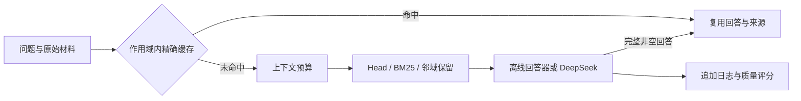
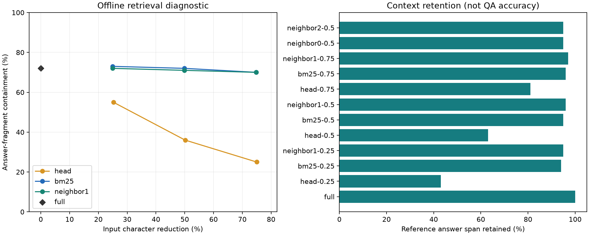
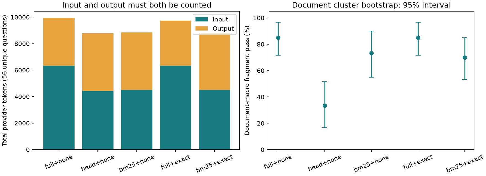
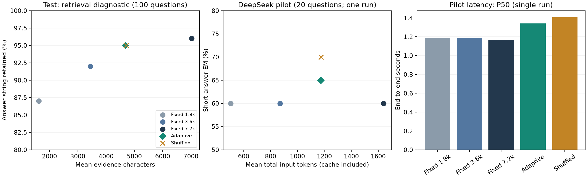

# Token Budget Lab

[](https://github.com/Wuuuucccyyy/Token-budget-lab/actions/workflows/test.yml)

本项目以任务准确率为首要目标，评估上下文筛选、回答缓存与 agent 历史恢复能否在满足质量要求的前提下降低 token 消耗，并改善端到端速度。实现包括 BM25 句子检索、邻域保留、精确/词面缓存、整库段落检索、自适应证据预算，以及可安装的 Python 历史中间件。

当前包含 **74 条合成请求的真实 API 实验**、**480 道公开数据问答及离线对照**、**20 道公开题 × 5 种证据预算的真实 DeepSeek 试验**，以及 **24 道历史记忆题 × 3 种模式、100 次真实调用**。不同任务分别报告，字符节省不冒充模型 token 节省，检索指标不冒充大模型准确率。

## Python Agent 历史插件

v0.5 提供模型调用前的历史筛选钩子：原始消息追加到 SQLite 归档，保留全部用户要求与更正、系统指令和最近轮次；按显式主体、字段及时间范围恢复原始工具整轮，不确定时完整回退。当前工具结果不替代本轮历史来源；Full 请求关闭恢复工具。宿主保留完整历史，压缩结果只用于单次请求。新增恢复去重、恢复轮次与业务步骤预算、任务内全量锁定，以及宿主声明的稳定只读工具控制。

```bash
python -m pip install .
python examples/python_memory_agent.py
```

示例默认离线，不请求模型。设置本机 `DEEPSEEK_API_KEY` 后可用 `--live --mode full` 或 `--live --mode recover` 做接入检查。核心安装仅依赖标准库；尚未发布到 PyPI，也尚未提供 MCP 或 LangChain 自动接入。

首轮 24 题真实试验中，恢复模式保留了标注来源消息，严格 JSON EM 为 70.8%，完整历史为 54.2%；这个差异受到输出格式失败影响，不能直接解释为事实质量提升。计入全部恢复调用后，总 token 仅减少 **0.18%**，P95 从 **1.029 秒**升至 **2.620 秒**。当前不支持默认启用或回答近乎无损且明显省 token 的结论。

接入接口、质量目标与边界见 [插件说明](docs/AGENT_MEMORY_PLUGIN.md)；设置、原始最终回答、格式诊断和逐题数值见 [记忆实验报告](results/agent_memory/REPORT.md)。

## 长历史与复杂任务对照

v0.5 针对重复恢复和工具循环做了两轮各 104 次真实调用，累计 208 次。固定实现复查包含 6 个长历史任务，两组各 18 个检查点；插件未出现步骤耗尽、截断或请求已关闭历史工具，但仍有历史版本使用错误及错误状态延续。

| v0.5 固定实现复查 | 原生 Full | 插件 |
|---|---:|---:|
| 检查点通过 | 17/18 | 16/18 |
| 完整任务通过 | 5/6 | 5/6 |
| 输入输出总 token | 1,161,991 | 886,068 |
| 检查点 P95 | 4.504 秒 | 6.078 秒 |

计入所有恢复、回退和失败后，总 token 减少 **23.7%**；真正发生压缩的 17 个检查点通过 16 个，但全任务质量仍低于 Full。两轮使用相同任务，后一次是诊断后的复查，不能证明近乎无损。每题仍最多 6 步，循环控制没有通过增加步骤上限改善结果。[完整设置、两轮费用与失败轨迹](results/recovery_guard/REPORT.md)。

以下保留 v0.4 的长度条件实验，不能与 v0.5 的专项样本直接比较百分比。

新增 24 个基础场景的短、中、长历史变体，共 72 个长度条件任务、216 个连续检查点。复杂任务覆盖两个字段计算、两个截止日期的版本比较、缺失信息判断与历史订单计算。历史由真实文件工具的脚本回放生成，后续操作由模型执行。

2026-10-11，固定实现对照运行 20 个长度条件任务，来自 8 个基础场景，两组各 60 个检查点，共 331 次 DeepSeek 调用。短档保留 4 个场景，中、长档各 8 个场景。

| 历史条件 | 初始历史字符均值 | Full 检查点通过 | 插件检查点通过 | 整任务总 token 变化 |
|---|---:|---:|---:|---:|
| 短 | 1,836 | 9/12 | 11/12 | 增加 2.3% |
| 中 | 25,355 | 23/24 | 23/24 | 增加 6.4% |
| 长 | 88,646 | 24/24 | 20/24 | 减少 17.5% |

短档没有压缩，首次历史和业务工具一致；通过率差异属于单次生成及后续轨迹的波动，不能解释为插件质量提升。

插件实际发送 75 次压缩视图、69 次全量回退及 32 次短历史完整视图。发生过压缩的 16 个任务中，计入全部恢复和回退后总 token 减少 12.0%，但完整任务通过率为 81.3%，相同任务的 Full 为 93.8%。整体检查点通过率为 Full 93.3%、插件 90.0%，总 token 减少 11.7%。当前仍未达到近乎无损要求；较长历史提供压缩空间，不能直接保证任务质量或净收益。

结果按完整任务、长度条件和实际压缩子集分开统计，失败保留。此前被中断的 130 次诊断尝试另行公开，两批累计 461 次尝试，含一次未知 usage。主对照是诊断后固定实现的单次合成试验，部分同批场景已用于诊断，不能作为独立确认。详细设置、速度和失败案例见 [长历史报告](results/agent_long_context/REPORT.md) 与 [协议](docs/LONG_CONTEXT_EVALUATION.md)。


## 连续工具任务评测

新增 24 个原创任务、72 个连续检查点，覆盖知识更新、时序、拒答和实际工具执行。模型需要写配置、计算旧订单金额、生成本地报告并实际运行检查；仅回答正确而未完成操作不能通过。

2026-10-11 的 4 任务 × 3 检查点 × 2 条件试验完成 60 次 DeepSeek 调用。原生 Full 与恢复插件都通过 12/12 检查点，但恢复组的全部 32 次请求都回退完整历史，总 token **增加 20.2%**。这说明当前回退和恢复调用仍需改进，不能解释为压缩无损。

另完成官方 LongMemEval Oracle 数据中更新、时序、拒答各 10 题的导入验证；没有官方生成成绩。原始数据固定版本和指纹，模型输入移除标签，Oracle 的预选证据性质另作标记。

```bash
python -m token_budget_lab.tool_experiment --config configs/agent_tools_offline.json --output local_results/tools-offline
```

该命令使用脚本调试策略和真实本地文件工具，不调用大模型；结果不能写成模型准确率。[评测协议](docs/AGENT_TOOL_EVALUATION.md) · [结果与工具审计](results/agent_tools/REPORT.md)。

## 快速运行

Python 3.10+；默认路径仅依赖标准库，无需 GPU 或 API Key。

```bash
python -m unittest discover -s tests -v
python scripts/reproduce.py --output local_results/public-reproduce
```

生成运行清单、逐请求日志、汇总、失败案例与待填写的人工复核表。需要图表时先安装 `requirements-analysis.txt`，再在复现命令末尾加 `--plots`。合成数据的原始入口仍为 `python -m token_budget_lab --output local_results/synthetic`。

## 方法与处理流程

评估依次检查：**任务质量 → token 消耗 → 端到端速度**。速度与 token 都是重要效率指标，但节省开销不能抵消答错问题。真实短答案任务先报告 EM/F1 与人工复核，再对满足质量要求的配置比较输入、输出和耗时；离线片段命中只作为诊断指标。

默认允许主质量指标下降为 0。新汇总采用同题配对、按材料聚类的差值区间进行筛查；区间跨越门槛时结论为不确定。该筛查限定于当前材料和自动评分，不能替代人工正确性检查，也不保证绝对准确率达到应用要求。



| 方法 | 选择依据 | 当前局限 |
|---|---|---|
| Full | 保留全部上下文 | 输入较长 |
| Head | 按原文顺序保留整句 | 容易丢失后部证据 |
| BM25 | 根据问题与句子的词项匹配排序 | 不充分处理同义词、指代与推理 |
| BM25 + 邻域 | 高分锚句附近的句子优先占用预算 | 可能挤掉远处证据；不保证改善 |
| 精确缓存 | 相同问题、材料、范围与配置 | 收益取决于重复比例 |
| 词面近似缓存 | 词项余弦相似度 | 仅在合成实验中研究，存在否定与数字误命中 |
| LLMLingua-2 post-fit | 可选学习式压缩及外层预算裁剪 | 已提供入口，尚未运行权重推理 |

半径 0 的邻域方法与 BM25 等价，半径 1、2 用于消融。所有评分标注仅在推理结束后使用。字符预算包含拼接换行，系统指令和问题保持完整。

## 公开数据与离线结果

数据来源为 SQuAD v1.1 的公开开发集：将同篇文章的段落组合成较长材料，每篇随机抽取 10 题，共 48 篇、480 题。文章长度约 1.5 万至 8.6 万字符。按文章隔离为 280/100/100 题。来源、固定版本、改编与许可见 [数据说明](data/PUBLIC_DATA.md)。

这是本项目的 SQuAD 文章级派生任务，不是官方榜单成绩，也不是 LongBench 复现。当前测试覆盖 12 个固定设置，不据测试结果选择最优参数。

| 策略（50% 字符预算） | 离线答案片段包含率 | 答案原文保留率 |
|---|---:|---:|
| Full | 72% | 100% |
| Head | 36% | 63% |
| BM25 | 72% | 95% |
| BM25 + 邻域半径 1 | 71% | 96% |

邻域方法多保留了一部分答案原文，但没有提升这轮离线回答指标。离线回答器返回相关句子，尚不能说明 DeepSeek 在这些材料上的表现。



完整表格、EM/F1、材料簇区间及逐题数值见 [公开数据报告](results/public/REPORT.md)、[统计摘要](results/public/summary.json) 和 [失败案例](results/public/FAILURE_CASES.md)。原始回答与上下文可通过固定配置重新生成。

## 已有 DeepSeek 实测

2026-10-09 的实验覆盖 74 条人工构造请求、20 份材料。去除 18 条精确重复后，BM25 的答案片段通过率从 87.5% 降到 78.6%；当前结果不足以支持其满足准确率优先的要求。输入总量从 6,339 降到 4,495 token（减少 29.1%），输出 token 同时从 3,605 增到 4,346。这些效率收益需放在质量损失的前提下理解。

计入重复请求的系统级比较中，BM25 + 精确缓存相对 Full 将调用从 74 次降到 56 次，输入 token 减少 46.4%。这个数字同时包含检索与缓存收益。



设置、材料簇置信区间以及一次未计量请求的限制见 [DeepSeek 报告](results/DEEPSEEK_EXPANDED_REPORT.md)。公开 CSV 可通过 `analysis.py` 重算，完整私有调用日志不进入仓库。

已有日志的端到端 P50/P95，以及缓存命中与未命中的分别耗时，见 [速度复核](results/latency/DEEPSEEK_LATENCY.md)。历史实验仅运行一轮且策略顺序固定，不能据此认定某方法稳定更快。新版请求计时包含缓存查询、上下文筛选和生成，排除评测与日志写入；尚未测首 token 延迟、并发吞吐量和模型冷启动。

## 自适应证据预算与 RAG 试验

新增流程从全部 48 篇文章的 2,258 个段落块检索证据，不预先提供正确文章。问题与候选匹配集中时采用小预算，候选分散、词项覆盖不足或问题较复杂时提高预算，再由 DeepSeek 输出带证据引用的短答案。三档上限为 1,800 / 3,600 / 7,200 **证据字符**；真实输入 token 另由 API usage 计量。

固定小、中、大预算与自适应方案共用检索器；打乱预算对照保留相同的名义预算分布。本轮关闭应用层缓存，保持检索方法不变，单独检验预算模块。

| 方法（20 道公开题，单次运行） | EM | F1 | 总输入 token | 输出 token | 端到端 P50 秒 |
|---|---:|---:|---:|---:|---:|
| 固定大预算 | 60% | 71.7% | 32,804 | 4,101 | 1.169 |
| 自适应预算 | 65% | 76.3% | 23,460 | 4,446 | 1.343 |
| 打乱自适应预算 | 70% | 79.4% | 23,486 | 4,153 | 1.407 |

自适应方案相对固定大预算减少输入 token 28.5%、输入输出合计 24.4%，但没有观察到相对打乱预算的质量优势，且本轮中位耗时更长。EM 的增加来自一题固定大预算输出截断，不能直接解释为检索证据更好。开发集/测试集离线诊断各 100 题；测试集答案字符串保留率为自适应 95%、固定大预算 96%。当前证据不足以宣称准确率不下降或稳定提速。

Anthropic 协议总输入按普通输入、缓存读取与缓存写入相加；缓存命中仍是模型输入，不能从输入 token 中扣除。服务商缓存影响费用与耗时，token 降幅不等于账单降幅。



完整设置、逐题 CSV、质量差区间与限制见 [预算实验报告](results/adaptive_budget/REPORT.md) 和 [案例复核](results/adaptive_budget/FAILURE_CASES.md)。离线复现无需 API：

```bash
python scripts/reproduce_rag_budget.py --output local_results/rag-budget-reproduce
```

真实生成入口为 `python -m token_budget_lab.rag_experiment`，配置与调用计划见报告。该试验从整库检索，历史实验给定正确文档，两者不能直接比较节省比例。

## 新版真实实验入口

在本机设置 `DEEPSEEK_API_KEY`，不把密钥写入仓库或聊天。PowerShell 可使用遮蔽输入：

```powershell
$deepseekSecret = Read-Host 'DeepSeek API Key' -AsSecureString
$env:DEEPSEEK_API_KEY = [System.Net.NetworkCredential]::new('', $deepseekSecret).Password
Remove-Variable deepseekSecret
```

将 `configs/deepseek_pilot.json` 的模型占位符改为账户可用模型 ID。先检查计划，再实际调用：

```bash
python -m token_budget_lab.experiment --config configs/deepseek_pilot.json --dry-run
python -m token_budget_lab.experiment --config configs/deepseek_pilot.json --output local_results/deepseek-public
```

计划从 10 篇开发集文章各取 1 题、比较 4 种方法，最多 40 次调用。真实运行产生费用；上限约束调用次数而不是金额。默认关闭思考模式、最多输出 512 token；与历史实验设置不同。

新流程保存数据/代码指纹、API 协议与思考设置、输入/输出 usage、压缩耗时、端到端 P50/P95、空答及截断。短答案试验统一使用相同回答格式指令，并以 EM 为主质量指标、F1 为补充。`--resume` 跳过已完成请求；可能已付费但状态不明的请求不会自动重发。公开数据的整库检索预算试验已执行；给定正确文章的压缩 API 对照与 LLMLingua-2 权重实验尚未执行，详见 [实验协议](docs/EXPERIMENTS.md)。

## 本地交互演示

```bash
python -m token_budget_lab.demo
```

浏览器打开 `http://127.0.0.1:8765`，输入问题与材料，切换方法和保留比例，查看被选中的句子、发送内容与字符预算。页面仅运行本地压缩。

## 代码与文档

| 路径 | 职责 |
|---|---|
| `core.py` | 分句、BM25、邻域预算与缓存 |
| `datasets.py` / `metrics.py` | 数据加载、参考答案与 EM/F1 |
| `experiment.py` / `deepseek.py` | 配置化运行、日志恢复、API 协议 |
| `evidence_budget.py` / `rag_experiment.py` | 整库段落索引、无标注预算规则、同题生成对照 |
| `memory.py` / `memory_agent.py` | 历史归档、原角色恢复、Python agent 调用前钩子与工具循环 |
| `memory_experiment.py` | 完整/只压缩/恢复对照、累计 usage 与格式评分 |
| `tool_tasks.py` / `tool_experiment.py` | 连续检查点、实际文件/CSV/检查工具、状态与任务评分 |
| `longmemeval_adapter.py` | 官方记忆数据导入、日期与标签分离、Oracle 标记 |
| `analysis.py` / `failures.py` | 聚类统计、图表、失败案例与复核表 |
| `configs/` / `scripts/` | 固定实验设置、数据重建、一键复现 |
| `tests/` | 预算边界、隔离、划分、恢复与模拟 API 测试 |

进一步说明：[历史插件](docs/AGENT_MEMORY_PLUGIN.md) · [实现说明](docs/CODE_WALKTHROUGH.md) · [技术背景与阅读路线](docs/LEARNING_GUIDE.md) · [研究计划](docs/RESEARCH_PLAN.md) · [实验协议](docs/EXPERIMENTS.md)。

## 来源、许可与研究边界

参考 [GPTCache](https://github.com/zilliztech/GPTCache)、[LLMLingua](https://github.com/microsoft/LLMLingua)、[Selective Context](https://aclanthology.org/2023.emnlp-main.391/) 与 [LongBench](https://github.com/THUDM/LongBench)。当前没有同条件复现 GPTCache / LLMLingua，不声称优于这些系统。

代码采用 [MIT](LICENSE)，合成数据为原创虚构资料；SQuAD 数据与改编按 [CC BY-SA 4.0](data/PUBLIC_DATA.md) 使用。字符数与实际模型 token、答案字符串与语义正确性、同文档问题与独立样本均分别处理。后续重点是公开数据的真实生成评测、匹配实际 token 预算、盲评与多轮运行。
