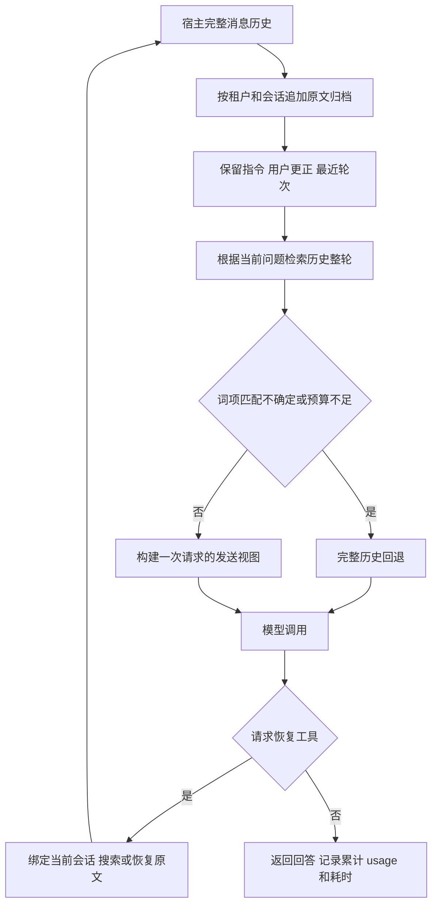

# Python Agent 历史压缩与恢复

## 目标与当前状态

目标是在原有 agent 的模型调用前筛选历史消息，并在缺少信息时恢复原文。验收顺序是任务正确性、累计输入输出 token、端到端速度。回答与完整历史版本的一致性另行统计：两个版本答得一样，并不说明都答对了。

v0.2 提供可安装的 Python 中间件、SQLite 原文归档、调用前钩子、三个历史恢复工具和 DeepSeek 参考 agent。当前是实验接口；尚未达到可默认启用的质量与效率要求。24 题的真实试验计入所有恢复调用后，总 token 仅减少 0.18%，P95 延迟上升。报告见 [历史记忆实验](../results/agent_memory/REPORT.md)。

首版的压缩方式是删除部分旧 assistant/tool 消息，不生成有损自然语言摘要。全部原始 user/system/developer 消息、最近两轮和恢复的整轮工具记录仍按原角色、原顺序发送。这样能直接保留用户要求与更正，但用户消息很长时压缩空间有限。

## 安装与运行

Python 3.10+，核心接口仅依赖标准库。在仓库目录安装：

```bash
python -m pip install .
python examples/python_memory_agent.py
```

第二条命令仅检查筛选结果，不请求模型、不测回答质量。构建 wheel 可使用 `python -m pip wheel . --no-deps --wheel-dir local_results/dist`。wheel 包含 Python 接口，实验数据、配置和示例从源码仓库运行；尚未发布到 PyPI。

本机设置 `DEEPSEEK_API_KEY` 后，显式启动真实模型：

```bash
python examples/python_memory_agent.py --live --mode full
python examples/python_memory_agent.py --live --mode recover
```

每次示例最多三次模型调用，会产生费用；两个命令并非完整实验。示例默认使用完整历史，恢复模式需显式选择。凭证不写入归档、结果或仓库。

## 接入已有 Python Agent

宿主保存完整的 `canonical_messages`；`PreparedHistory.messages` 只作为一次模型请求的发送视图。完整状态必须追加模型回答、工具返回和后续用户请求，不得被发送视图覆盖。

```python
from token_budget_lab.memory import HistoryArchive, MemoryPlugin
from token_budget_lab.memory_agent import DeepSeekChat, run_agent

archive = HistoryArchive("local_results/history.sqlite3")
plugin = MemoryPlugin(archive, budget=9000, recent_turns=2)
try:
    result = run_agent(
        canonical_messages,
        transport=DeepSeekChat(model="deepseek-flash", max_tokens=1024),
        plugin=plugin,
        tenant="my-app-user-1",
        session="conversation-1",
        mode="recover",  # 实验模式；完整历史对照使用 full
        max_steps=4,
        extra_tools=my_tool_schemas,
        handlers=my_tool_handlers,
    )
    canonical_messages = result["messages"]
finally:
    archive.close()
```

`my_tool_schemas` 是 Chat Completions function tools 列表；`my_tool_handlers` 是名称到本地可调用函数的映射。宿主负责工具权限和业务约束。恢复原文不执行历史工具，只重放已有消息记录。

也可仅使用 `plugin.before_model(tenant, session, canonical_messages, mode="recover")` 接入自有调用循环。此时宿主需注册 `HISTORY_TOOLS`，调用 `memory_tool`，追加成对的 assistant/tool 消息，再次准备请求。恢复请求只对当前用户轮次生效，后续轮次重新检索。

`DeepSeekChat` 是非流式同步参考传输层，使用官方 Chat Completions 地址、关闭思考模式，不自动重试；自定义传输层返回 assistant message、usage 和 finish_reason，并以 `last` 保留已知 usage。当前没有 LangChain/MCP 自动接入，也没有与任意 agent 无缝兼容的承诺。

## 数据流



归档按消息位置存储原文及 SHA-256，拒绝同会话历史缩短或已有消息修改。工具消息必须有对应调用；待处理的工具调用需要全部返回后才能发起下一次模型请求。删除和恢复都以用户轮次为组，恢复到原来的角色和顺序，不把旧工具内容提升为 system 指令。

`history_search(query)` 返回整轮 ID、分数和短预览；`history_restore(turn_ids)` 请求下次调用注入原始整轮；`history_restore_all()` 请求完整历史回退。模型不传入租户/会话参数，这些由宿主绑定。预览和归档通知是元数据，不能作为事实正确性的证明。

当前规则用标识符词项、BM25 排名差和词项覆盖筛选证据；汇总、比较及明显时序问题直接回退。低置信候选也回退。阈值是回归规则，不是校准后的正确概率，也不能识别所有指代、否定或跨轮依赖。

## 预算与成本

默认预算 9,000 个序列化消息字符，包含选中消息和归档通知；它不是模型 token 上限，也不含 function tools 的 schema。调用总输入、工具 schema、恢复后的重复输入及输出均由 API usage 计量。

预算是软上限：保护内容或恢复内容放不下时使用完整历史。若完整历史本身超过模型窗口，宿主仍需拒绝请求或采用其他策略；本插件不会通过截断必要内容强行满足限制。恢复多一次意味着又支付一次模型调用，初始历史变短不能等同于最终成本降低。

## 质量验收

主质量指标默认允许下降为 0；应用应在验证前明确绝对正确率、关键约束错误容忍度，以及统计上的可接受误差。当前小样本不能证明无损，也不宣称非劣效成立。

后续验收需要固定独立测试会话、多轮任务和重复运行：分别统计事实正确性、输出格式、任务完成率、与完整历史的答案一致性、约束违背，以及按会话聚类的配对质量差区间。仅观察“来源消息存在”不能代替生成评分；基线本身答错时应以参考答案或盲评为准。自动评分与人工语义复核单独报告。

只有质量达到预设要求的配置才比较总 token 和 P50/P95。统计必须覆盖搜索、恢复、重答、失败请求、压缩及索引耗时，不能只统计首次调用。当前真实试验保留严格格式评分，并提供明确标注为事后诊断的裸值评分，不据后者改写主结果。

## 已知边界与下一步

- SQLite 当前为单进程同步归档，不支持多写者、异步流式调用和事务性的工具执行。会话键隔离不是文件加密或外部服务的访问控制。
- 全部用户消息受保护；没有事实摘要和自动过期管理。历史增长时归档扫描、索引重建和内存索引也会增加开销。
- 目前主要检索显式标识符；中文指代、同义表达、隐藏依赖、用户更正的时间语义和恶意历史指令都需要专项测试。
- 真实试验只有 4 个开发会话、24 题，题型固定，且工具日志加入了重复噪声。尚未覆盖自然流量、实际代码修改或长程执行任务。

下一轮首先消除提示词格式冲突，并减少已恢复证据的重复搜索和恢复。改动固定后再做独立测试，不能以调试后的同批样本作为确认结果。随后引入原文出处明确的事实索引、混合检索与重排，保留“恢复整轮”和“完整历史回退”路径。

框架对接应优先采用宿主的模型调用前钩子。LangChain 的 [middleware](https://docs.langchain.com/oss/python/langchain/middleware/built-in) 可作为后续集成点；[MCP tools](https://modelcontextprotocol.io/specification/2025-11-25/server/tools) 可提供历史检索和恢复服务，但单独的 MCP 工具不能自动改写宿主发给模型的全部历史。记忆评测可参考 [LongMemEval](https://github.com/xiaowu0162/LongMemEval)，本仓库尚未运行其官方数据。
