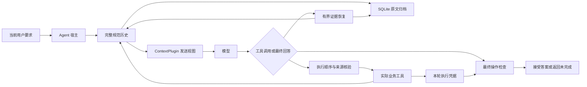

# 架构与设计约束

插件位于 agent 宿主与模型请求之间。宿主维护完整规范消息；SQLite 保存原文，发送视图负责控制历史与大工具输出的大小。执行检查处理操作完成情况；历史来源核验处理指定快照版本，本轮数值核验处理实际读取到写入之间的变换。

## 原文与发送视图

归档按 tenant/session 隔离。已经存入的规范消息只能追加，不能缩短或替换；原文 SHA-256 用于检测归档内容变化。assistant 的 tool_calls 与对应 tool 返回保持成组，准备请求前拒绝孤立返回或未完成调用链。

宿主声明可外置的工具名。大结果转换成稳定归档入口，包括来源 ID 和原始大小，不塞入任意开头预览。来源 ID 结合消息位置与原文指纹，不是“已经完成任务”的证明。

在一个用户任务内，历史选择与工具定义保持固定，新消息追加在尾部。新用户任务可能重新选择历史。未知证据需求保留小型原文；用户要求、系统约束及必要来源优先于软预算。前缀稳定性改善缓存条件，实际命中与费用仍以服务商 usage 为准。

## 证据恢复

`context_read` 读取当前会话的精确原文或 RFC6901 JSON pointer，最多返回 2,000 字符，提供下一页位置。`context_search` 使用词面索引返回有界片段，不索引自身的恢复结果。未命中不证明事实不存在。

v0.9 默认采用结构化定位。`context_find` 在指定来源中按字符串字段值匹配 JSON 对象，返回实际对象位置、字段路径、完整小对象或必要字段；事件编号不作为数组下标。匹配总数、是否有重复及未返回的候选明确标记。

全局 `context_search` 对明确事件/id 返回对象和路径；自由文本围绕查询命中提取片段并返回原文偏移。较大对象不剪成不完整 JSON，字段超过返回预算时提供路径。响应仍有长度上限。

`evidence_mode="lexical"` 用于同轮对照，保留原来的片段头部和两种工具。默认 `structured` 增加 `context_find` 及入口提示。这个变化不自动选择时间上的有效版本，也不验证模型如何变换已经读取的值。

## 执行与来源

`ActionContract` 声明必需业务工具、参数、返回条件与依赖。只有实际 handler 调用生成本轮凭据；历史记录和缓存回显不生成新凭据。`after` 依赖的先后顺序以调用序号核对，后续写入会使旧检查失效。需要再次实际读取时绕过稳定读取回显。

`HistoricalWriteGuard` 只核验宿主声明的配置写入，依据任务开始前的原始快照、主体、观察日期、字段与运算。缺失日期、同日冲突或不支持的运算会拒绝写入。观察日期不是所有业务事实的有效期。

`FreshWriteGuard` 由宿主声明实际读取参数、字段选择与变换。只有本轮实际 handler 返回建立来源；来源 ID、原文指纹与字段位置随每次核验记录。宿主使用 Decimal 重算格式化或整数偏移，再决定是否允许调用写 handler。不接受模型自报来源或恢复回显作为新读取，不自动修正数值或写入。

请求中的规则提示在任务内固定，原值和目标值不进入初次规则提示。支持的源修改工具会在执行前使旧来源失效，新读取失败不能回退到先前成功结果。未知工具修改关系、外部并发变更和任意自然语言运算需要宿主补充规则。

开启 eager_evidence 后，原始读取结果进入规范历史，再由同一宿主 selector 生成短原文字段投影。投影只放入该实际来源的发送视图，来源 ID 与原文指纹必须匹配，不添加格式化后的目标答案。大结果仍完整归档；单来源投影不超过 1,600 字符，未知格式保留恢复入口。

这些接口不能单独证明最终回答正确。即使文件与检查均正确，模型也可能没有在步骤上限内输出答案。完整任务评分仍核对最终回答与所有操作。

## 终止与计量

重复恢复返回重复请求信息；恢复轮次有上限，连续无进展会终止。缺少必需操作时退回临时答案，补做仍受 `max_steps` 限制。当前默认十步，任务提前完成即结束；耗尽步骤、恢复停滞、工具异常和输出截断都保留为失败。

模型响应的 usage 在业务工具可能修改状态之前记录。完整任务计入恢复、重复请求、失败和最终输出；缓存命中输入仍是 token，按不同价格核算。缺失或不一致的缓存分项不能当作零费用。
