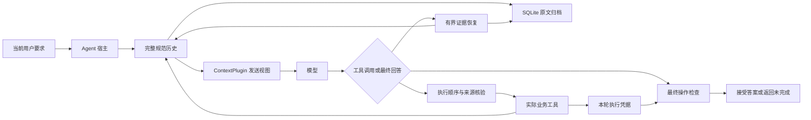

# 架构与设计约束

插件位于 agent 宿主与模型请求之间。宿主维护完整规范消息；SQLite 保存原文，发送视图负责控制历史与大工具输出的大小。执行检查和历史来源核验分别处理操作完成情况与事实版本。

## 原文与发送视图

归档按 tenant/session 隔离。已经存入的规范消息只能追加，不能缩短或替换；原文 SHA-256 用于检测归档内容变化。assistant 的 tool_calls 与对应 tool 返回保持成组，准备请求前拒绝孤立返回或未完成调用链。

宿主声明可外置的工具名。大结果转换成稳定归档入口，包括来源 ID 和原始大小，不塞入任意开头预览。来源 ID 结合消息位置与原文指纹，不是“已经完成任务”的证明。

在一个用户任务内，历史选择与工具定义保持固定，新消息追加在尾部。新用户任务可能重新选择历史。未知证据需求保留小型原文；用户要求、系统约束及必要来源优先于软预算。前缀稳定性改善缓存条件，实际命中与费用仍以服务商 usage 为准。

## 证据恢复

`context_read` 读取当前会话的精确原文或 RFC6901 JSON pointer，最多返回 2,000 字符，提供下一页位置。`context_search` 使用词面索引返回有界片段，不索引自身的恢复结果。未命中不证明事实不存在。

当前搜索返回命中文本块的前 500 字符，可能截在目标事件之前；来源虽然被命中，模型仍可能错误分页。这是下一轮精确定位的重点。

## 执行与来源

`ActionContract` 声明必需业务工具、参数、返回条件与依赖。只有实际 handler 调用生成本轮凭据；历史记录和缓存回显不生成新凭据。`after` 依赖的先后顺序以调用序号核对，后续写入会使旧检查失效。需要再次实际读取时绕过稳定读取回显。

`HistoricalWriteGuard` 只核验宿主声明的配置写入，依据任务开始前的原始快照、主体、观察日期、字段与运算。缺失日期、同日冲突或不支持的运算会拒绝写入。观察日期不是所有业务事实的有效期。

这两个接口不能单独证明最终回答正确。尤其是本轮读取完成后，模型仍可能使用另一份旧来源的值；需要将写入证明与本轮读取结果进一步绑定。

## 终止与计量

重复恢复返回重复请求信息；恢复轮次有上限，连续无进展会终止。缺少必需操作时退回临时答案，补做仍受原有 `max_steps` 限制。耗尽步骤、恢复停滞、工具异常和输出截断都保留为失败。

模型响应的 usage 在业务工具可能修改状态之前记录。完整任务计入恢复、重复请求、失败和最终输出；缓存命中输入仍是 token，按不同价格核算。缺失或不一致的缓存分项不能当作零费用。
