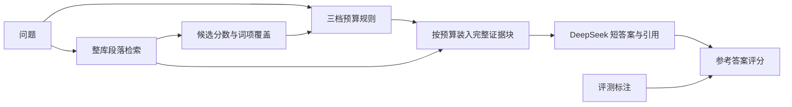

# 按证据需求分配输入预算

本项目将上下文预算从固定比例扩展为按问题分配的三档上限。研究目标是在满足任务质量要求的前提下，给证据集中问题较小输入，给候选分散或复杂问题更多证据空间。第一版使用可解释的词面信号，尚未训练证据充分性分类器。

## 检索与预算的分工

`EvidenceIndex` 在全部文章上建立 BM25 倒排索引。问题检索前 24 个候选块，预算模块决定允许送入多少证据，`pack_evidence` 再按同一排名装入完整块。整个流程不读取参考答案、正确文章 ID 或来源段落标注。

分块保留原文偏移和文章名；常规段落不按英文句点拆开，以避免姓名缩写与小数被割裂。过长段落采用最长 1,200 字符窗口及 160 字符重叠。装入时去除高度重叠的块，保留 `[E1]` 等引用编号。标题、偏移与分隔符都占证据预算；问题和统一回答指令另计为输入。

## 预算规则

对问题中的有效检索词，计算首候选正文的 IDF 加权覆盖率。分数差定义为 `(score_1 - score_2) / score_1`，只反映本次 BM25 排名的集中程度，不是概率或模型置信度。规则按下表顺序匹配：

| 条件 | 证据上限（字符） | 原因标签 |
|---|---:|---|
| 没有候选 | 1,800 | `no_candidates` |
| 包含比较、原因、先后等预设问句模式 | 7,200 | `complex_question` |
| 首候选词项覆盖率低于 0.60 | 7,200 | `weak_term_coverage` |
| 前两名相对分数差低于 0.15 | 7,200 | `ambiguous_candidates` |
| 覆盖率至少 0.80 且分数差至少 0.35 | 1,800 | `concentrated_lexical_match` |
| 其余 | 3,600 | `moderate_lexical_match` |

预算控制单位为证据字符，不是 DeepSeek tokenizer 的精确 token 上限。模型实际输入与输出从 usage 计量。候选数、完整块装入、块长和去重会影响实际证据长度，名义上限相同不意味着实际 token 相同。

## 对照与评测

五种方法共用分块、索引、候选排名、完整块装入和生成提示，只改变预算来源：三个固定档位、自适应规则，以及打乱自适应预算的分配。打乱对照保持预算多重集合相同，仍须核对实际输入量；目前只使用一个打乱种子。

离线仅统计答案字符串保留、完整来源段落覆盖和候选召回，不生成模拟准确率。真实生成统一使用 JSON 短答案和引用格式，以 EM/F1 评分；空答、无效格式、截断与拒答参与质量分母。引用 ID 校验不能替代证据支持度评审。

当前 RAG 试验使用整库检索，旧上下文压缩试验预先给定正确文章。后者不测检索是否找到正确文章，两类结果应分开解读。资料库包括所有划分的文章，开发/测试仅划分评测问题，不代表对未知知识库的外推。

## 第一轮发现

开发集与测试集各 100 题的离线诊断，以及开发集 20 题、100 次 DeepSeek 调用均已执行。相对固定大预算，自适应试验减少总输入 token 28.5%，但没有观察到相对打乱预算的质量优势，也未改善本轮中位响应速度。

词面信号容易受到同义表达、重复候选及问题长度影响：相邻重叠块分数接近时不一定有证据歧义；缺少词项也不一定需要更多上下文。完整来源段落保留仍可能答错。下一轮应先在开发集研究候选按证据去重、问题分面覆盖与重排，再冻结规则进行独立生成评测。

完整数字、运行设置与复现入口见 [实验报告](../results/adaptive_budget/REPORT.md)；具体差异见 [案例复核](../results/adaptive_budget/FAILURE_CASES.md)。
