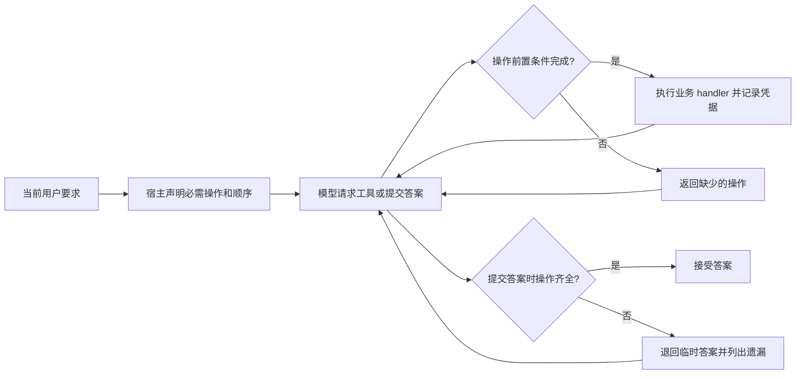

# 指定操作的执行检查

v0.7 增加独立的 `ActionContract`，约束本轮必须实际执行的业务操作。它可同时用于原生 Full 与上下文插件。读取历史证据和读取现在的文件是不同操作：归档里存在同名文件的结果，不能完成用户明确提出的“现在实际读取”。

## 宿主负责判定任务是否完成

原有流程允许模型直接输出最终答案，再由评测发现工具遗漏。新流程由宿主保存实际 handler 调用的执行凭据，写入前检查依赖，结束前检查必需操作。



模型陈述“已读取”、历史 assistant/tool 消息、`context_read` / `history_restore`、稳定读取的缓存回显都不生成新的业务执行凭据。读错文件也不满足指定参数约束。调用异常、返回非空 `error` 或 `success=false` 不计完成；检查、写入等业务成功条件通过 `result_matches` 明确声明。

凭据只在一次 `run_agent` 中有效，下一个用户任务重新建立。它记录实际参数、结果指纹和匹配的要求，原始结果仍位于实际工具返回中。结果指纹用于关联原文，不证明原文内容正确。

## Python 接入

```python
from token_budget_lab.action_contract import ActionContract, RequiredAction
from token_budget_lab.memory_agent import run_agent

# 这些操作来自本轮用户要求，不能从参考答案或模型自拟计划中推导。
contract = ActionContract([
    RequiredAction("fresh_scan", "read_log", {"name": "scan_c"}),
    RequiredAction("report", "write_report", after=("fresh_scan",),
                   result_matches={"written": True}),
    RequiredAction("checks", "run_checks", after=("report",),
                   result_matches={"passed": True}),
], before_tools={
    "write_report": ["fresh_scan"],
    "run_checks": ["report"],
})

result = run_agent(
    canonical_messages, transport, plugin, tenant="app-user", session="conversation",
    mode="recover", max_steps=6, max_recovery_rounds=3,
    extra_tools=tool_schemas, handlers=tool_handlers,
    action_contract=contract,
)
if result["status"] == "ok":
    assert result["action_contract"]["complete"]
else:
    missing = result["action_contract"]["missing"]
```

Full 对照使用同一个 contract，并传 `plugin=None, mode="full", memory_tools=False`。接口是可选参数，原有调用方式保留。完整示例见 [python_required_actions.py](../examples/python_required_actions.py)。

`arguments` 按带类型的子集匹配，包括嵌套对象；`True` 不等于整数 `1`。`result_matches` 可规定 `passed=true` 等返回值约束；空约束不假定任意工具都有统一的成功字段。宿主应让错误通过异常或明确的错误返回表达，异步提交成功也不能直接当作异步任务完成。

`after` 要求操作发生在其依赖之后。如果写入再次执行，之前的检查会变旧，需要重新检查。`before_tools` 保护列出的工具的所有调用，包括参数与目标操作不匹配的调用，防止绕开读取依赖。多次读取要求需要明确的顺序依赖；一个读取回执不能同时满足有先后关系的两次读取。

## 与压缩、缓存和步数预算配合

执行合同作为固定元数据插在当前任务边界，保留旧前缀；任务内工具定义保持固定。缺少执行凭据时，反馈只追加到消息末尾。补读会产生模型调用和输入输出消耗，全部计入完整任务。

指定读取得到大结果后，插件仍将结果外置。模型应使用这次返回的 `source_id` 恢复必要字段，而不是改用旧历史的同名文件。当前实现检查操作是否执行，不单独认证模型最终答案或每个写入值确实来自这次读取；这些仍由来源核验和任务评分检查。

补做操作不会增加 `max_steps`。步数耗尽仍缺操作时返回 `action_incomplete`，答案不被接受；已完成操作却没有新的最终答案时返回 `step_limit`。连续恢复失败和 API 错误保留原有失败状态及遗漏清单。宿主不会替模型自动执行未请求的业务写入。

## 能保证的范围

执行合同来自宿主的结构化用户需求。参考接入显式声明工具、参数与顺序，尚未提供通用自然语言自动提取。任意自由文本都需要先可靠地转成合同；漏提取的要求不会自动获得保护。

合同只能保证已声明操作不能在无凭据时被视为完成，不能保证模型一定在有限步数内完成，也不能保证答案正确。所有实际业务调用必须经过此 dispatch；旁路调用、外部并发文件更新、返回内容不可信及未声明的领域约束需要宿主额外处理。

实验包括两条旧任务复查和四条当前文件更新任务，全部采用六步上限；Full 与插件均有启用/不启用合同的组别。真实调用结果和失败保留见 [专项报告](../results/action_contract/REPORT.md)。这些合成诊断不能证明任意 agent 任务近乎无损。
