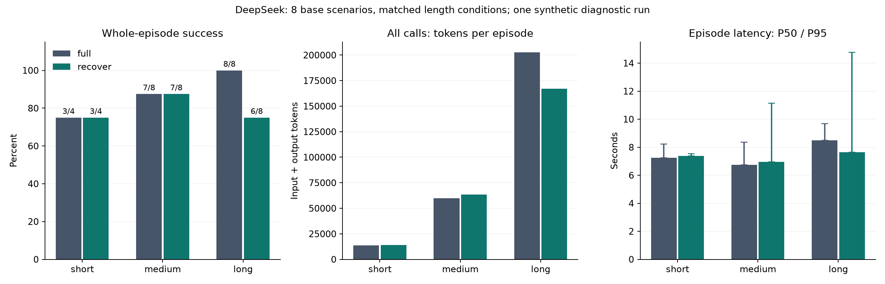

# 长历史证据选择与连续工具实验

2026-10-11，v0.4，DeepSeek 真实生成。主要问题是：当历史增长、当前任务只需要其中部分证据时，按事实和时间选择原文能否减少整个任务的 token，同时保持任务正确性。

## 设置

- 本轮包含 20 个长度条件任务、8 个基础场景，两组各 60 个连续检查点。各类型场景来自同一合成模板，不是独立自然任务。
- 长度分布为 `{'short': 4, 'long': 8, 'medium': 8}`；相同场景的长度变体不作为新的独立场景。
- 原生 Full 不使用插件、归档和恢复工具；恢复组按主体、字段和日期选原始整轮。当前工具链及全部用户要求保留。Full 请求关闭恢复工具。
- 统一业务工具、JSON 输出、关闭思考模式，模型 `deepseek-flash`，每次最多输出 1,024 token。方法顺序按固定种子随机化。
- 配置是 9,000 个序列化字符、当前整轮窗口 1、预计至少减少 10% 字符。字符比例不冒充 API token 节省。
- 历史由真实本地文件读取的脚本回放生成；检查点由模型自主执行。模型需要计算、写文件和运行 Python 检查，不能只给正确答案。

## 整体结果

| 指标 | 原生 Full | 恢复插件 |
|---|---:|---:|
| 检查点通过率 | 93.3% | 90.0% |
| 完整任务通过率 | 90.0% | 80.0% |
| 答案准确率 | 95.0% | 90.0% |
| 文件状态准确率 | 93.3% | 95.0% |
| 模型请求 | 155 | 176 |
| 恢复工具函数请求（含拒绝） | 0 | 43 |
| 输入 token | 2,148,304 | 1,894,290 |
| 输出 token | 5,676 | 8,238 |
| 输入输出合计 | 2,153,980 | 1,902,528 |
| 未知 usage 请求 | 0 | 0 |
| 检查点 P50 秒 | 2.631 | 2.566 |
| 检查点 P95 秒 | 4.346 | 6.214 |

计入所有请求后，总 token 减少 11.7%。这个比例是模型输入输出用量，不是账单降幅。
恢复组请求模式为 `{'full': 32, 'compressed': 75, 'fallback_full': 69}`；回退及保留原因见逐请求 CSV。

## 长度条件

| 条件 | 每组任务数 | 初始历史字符均值 | Full 检查点通过 | 插件检查点通过 | Full 完整任务通过 | 插件完整任务通过 | 总 token 减少 | 压缩请求/插件请求 |
|---|---:|---:|---:|---:|---:|---:|---:|---:|
| short | 4 | 1,836 | 75.0% | 91.7% | 75.0% | 75.0% | -2.3% | 0/32 |
| medium | 8 | 25,355 | 95.8% | 95.8% | 87.5% | 87.5% | -6.4% | 35/68 |
| long | 8 | 88,646 | 100.0% | 83.3% | 100.0% | 75.0% | 17.5% | 40/76 |

同一条件下两组比较相同任务。short 样本数较少；不同条件的原始 token 总量不直接用于比较效率。图中成本按完整任务平均。
short 未压缩、未注册恢复工具，四个场景第一次请求的历史哈希一致。两组通过率的差异不能归因于压缩收益，单次生成及后续轨迹有波动。

## 实际发生压缩的任务

- 至少一次压缩的任务：16 个，来自 8 个基础场景。
- 这些任务的完整任务通过率：插件 81.2%，相同任务的 Full 93.8%。
- 这些任务的全部检查点通过率：插件 89.6%，相同检查点的 Full 97.9%。
- 实际压缩的检查点：36 个，通过率 88.9%。
- 这些任务计入恢复及回退的全部请求后，总 token 减少 12.0%。
- 配对质量差按 base_id 聚类：`{'documents': 8, 'macro_mean': -0.08333333333333333, 'ci95': [-0.22916666666666666, 0.041666666666666664], 'draws': 2000, 'seed': 20261011}`。

压缩子集是事后诊断，包含失败任务；不能通过只看此子集证明总体质量不下降。

## 中断的诊断调用

在固定实现前发现本轮写入结果会替换原问题的历史来源，停止了 130 次尝试的诊断运行。已知 usage 和完成的失败任务保存在 `interrupted_diagnostic/`，没有删掉或并入固定实现的主对照。
两批合计 461 次尝试；未知 usage 为 1 次。`usage_ledger.json` 计入诊断与主对照所有已知输入输出，不把未知请求当成零成本。
主对照使用诊断后固定的实现；部分同批测试场景已在诊断中被观察，因此这是一轮原型诊断结果，不是独立确认实验。

## 失败与限制

- 长历史增加可删除的信息量，但复杂问题仍可能导致错误选择、漏执行工具及后续状态错误。三个连续阶段不自动修复，错误会传递。
- 模型可能重复请求恢复，或在恢复工具关闭后仍生成未注册函数请求。宿主拒绝未注册工具；调用耗尽六步上限时任务失败。逐步轨迹见 [失败案例](FAILURE_CASES.md)。
- 结构化选择依赖明确主体、字段和日期；任意自然语言、隐含指代、多步隐藏依赖没有得到充分验证。
- 9,000 字符上限较保守。受保护的当前工具输出过大时会回退，即使旧历史可压缩，也可能没有净收益。
- 一个种子、一次运行、有限模板；按基础场景聚类的区间不意味着已证明近乎无损。没有生产流量或官方 LongMemEval 成绩。
- 服务商缓存和网络影响速度与价格，未测并发及首 token 延迟。完整任务延迟包括历史准备、所有模型调用和业务工具，排除初始回放及评分。

## 审计与复现

- `deepseek_test/per_request.csv`：实际请求模式、选择原因、字段与日期需求、恢复工具开关及 usage。
- `deepseek_test/per_checkpoint.csv`：答案、文件状态、操作完成、约束与累计请求数。
- `deepseek_test/per_episode.csv`：所有任务的累计 token、实际压缩请求、回退请求与完整任务通过。
- `deepseek_test/business_actions.csv`、`artifact_states.json`、`final_answers.csv`：业务执行、最终文件状态及原始回答。
- `offline_dev/summary.json`：脚本驱动检查，API token 和大模型准确率为空。
- [协议与运行命令](../../docs/LONG_CONTEXT_EVALUATION.md)。

### 未通过检查点

| 任务 | 条件 | 阶段 | 实际答案 | 答案正确 | 状态正确 | 必需工具完成 |
|---|---|---:|---|---|---|---|
| temporal-03-short | full | 0 | 1 | False | False | True |
| temporal-03-short | full | 1 | 1 | False | False | True |
| temporal-03-short | full | 2 | PASS | True | False | True |
| temporal-03-short | recover | 0 | UNKNOWN | False | False | False |
| temporal-03-long | recover | 0 | 空 | False | False | False |
| temporal-03-long | recover | 1 | 空 | False | True | False |
| temporal-05-long | recover | 0 | 空 | False | True | False |
| temporal-05-long | recover | 1 | 空 | False | True | False |
| temporal-03-medium | recover | 0 | 空 | False | False | False |
| knowledge_update-03-medium | full | 0 | 空 | False | False | False |

